# Benchmarks

Two machines:

| Machine | GPU | CPU |
| --- | --- | --- |
| Workstation | NVIDIA RTX A6000, SM clock locked at 1200 MHz, CUDA runtime 13.4, driver 595.91 | AMD Threadripper PRO 5995WX, 128 threads |
| Laptop | Apple M3 Pro, through Metal | M3 Pro, 6 performance and 6 efficiency cores |

VkFFT runs against the FFT each device already has: cuFFT through CUDA.jl on
the A6000, MPSGraph through Metal.jl on the M3 Pro, and FFTW on the CPU. On the
A6000 VkFFT runs through CUDA and through OpenCL. On the laptop OpenCL is pocl,
on the CPU.

Each sweep runs five times, each in a fresh process. A sample queues a batch of
transforms, about 5 ms of work, and waits once, so the times are what a loop of
`mul!` calls costs per transform. A time is the median across the five runs,
and the bands and whiskers span them. Transforms that overwrite their input,
in place and `irfft`, cannot be batched, so their samples are one call plus one
wait.

The harness is in `benchmarks/` in the repository. `benchmarks/run.jl` measures
and `benchmarks/plot.jl` draws these figures from its output.

## Speed against cuFFT, MPSGraph and FFTW

```@raw html
<div class="docs-light-only">
```
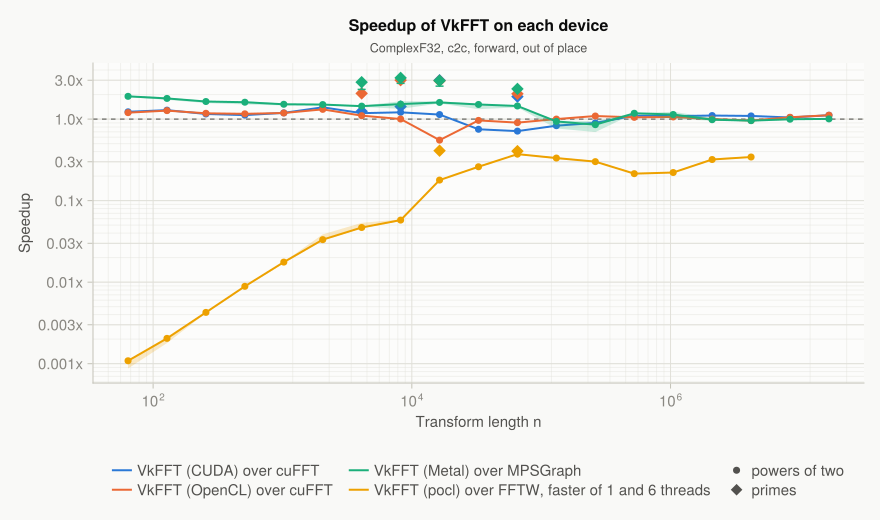
```@raw html
</div><div class="docs-dark-only">
```
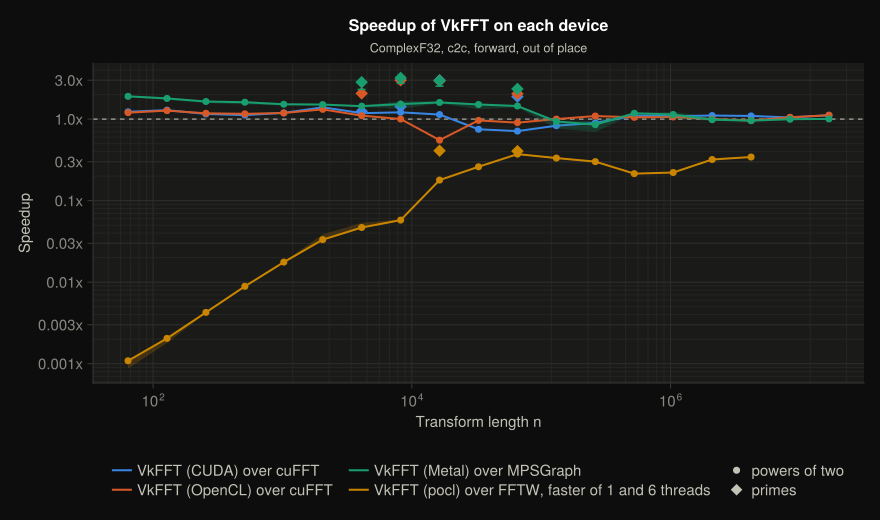
```@raw html
</div>
```

Above 1x VkFFT is faster. Over every case measured, VkFFT beats cuFFT in 186 of
235 by a geometric mean of 1.29x, and MPSGraph in 175 of 204 by 1.47x. Prime
lengths, which run through Bluestein's algorithm, are where VkFFT leads most.

cuFFT is faster from ``2^{15}`` to ``2^{18}`` in single precision, and MPSGraph
at ``2^{17}`` and ``2^{18}``. Past ``2^{20}`` both stay within about 10% of
VkFFT.

On a CPU, FFTW is faster than VkFFT through pocl at every length here. Use
VkFFTOpenCL on a CPU when you need the same code to run without a GPU, not for
speed.

## Time per transform

```@raw html
<div class="docs-light-only">
```
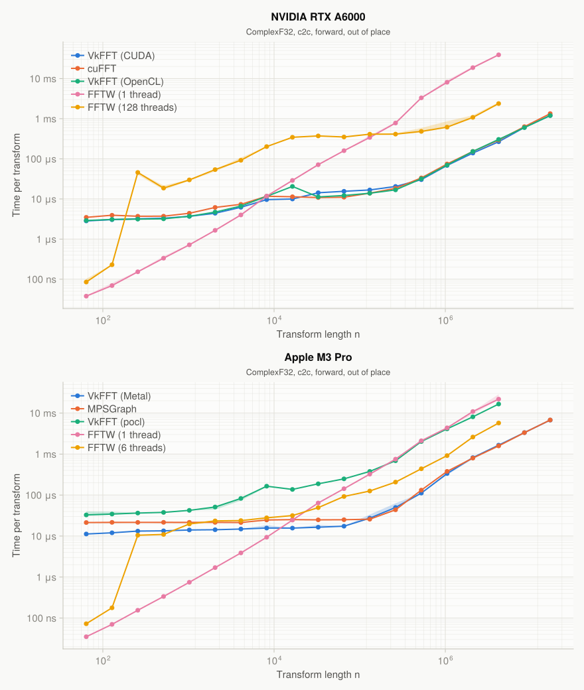
```@raw html
</div><div class="docs-dark-only">
```
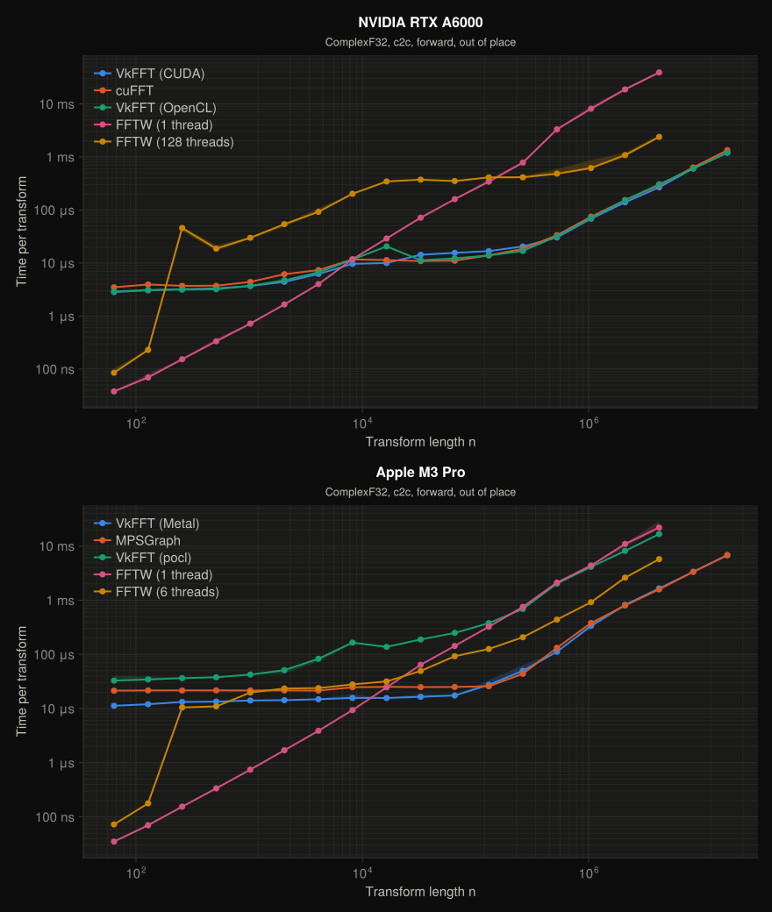
```@raw html
</div>
```

The flat stretch on the left is the cost of queueing one transform, about 3 μs
for VkFFT on CUDA and 11 to 15 μs on Metal. MPSGraph sits at about 21 μs.

The GPU overtakes the faster of the two FFTW runs at 8192 points on the A6000
and at 16384 on the M3 Pro. Below that, keep small transforms on the CPU.

## Lengths around 4096

```@raw html
<div class="docs-light-only">
```
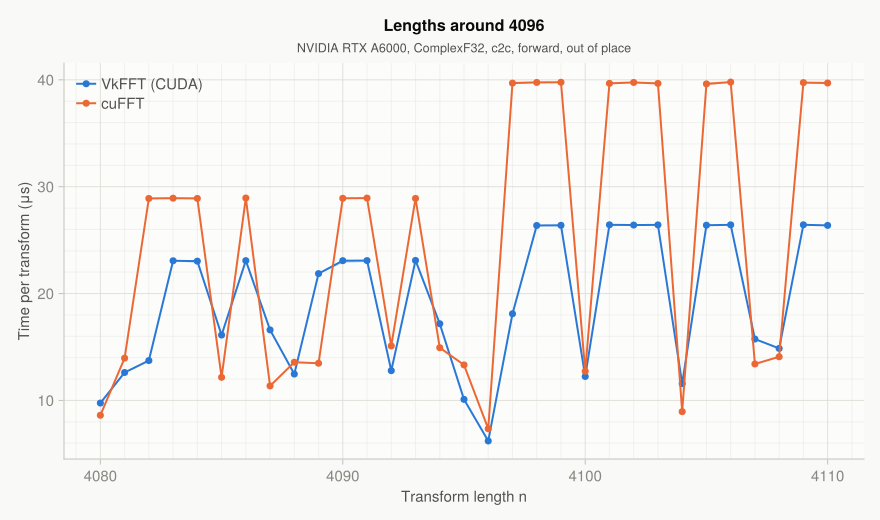
```@raw html
</div><div class="docs-dark-only">
```
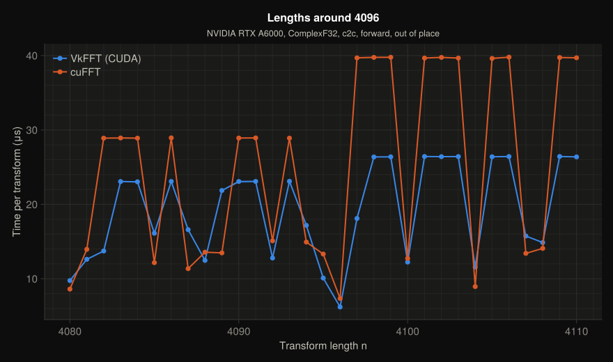
```@raw html
</div>
```

Both libraries run 4096 points in 6 to 7 μs. Neighbouring lengths cost
depending on how they factor, not on their distance from 4096. A length with a
large prime factor goes through Bluestein's algorithm, where VkFFT takes 23 to
26 μs and cuFFT 29 to 40 μs.

## CUDA and OpenCL on one A6000

```@raw html
<div class="docs-light-only">
```
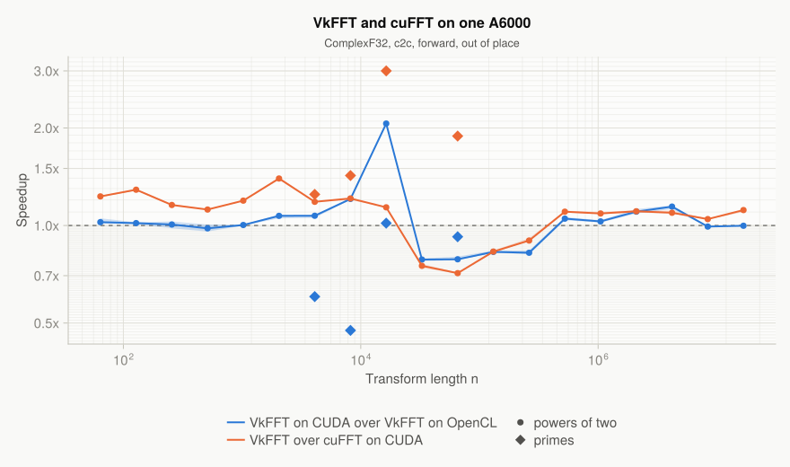
```@raw html
</div><div class="docs-dark-only">
```
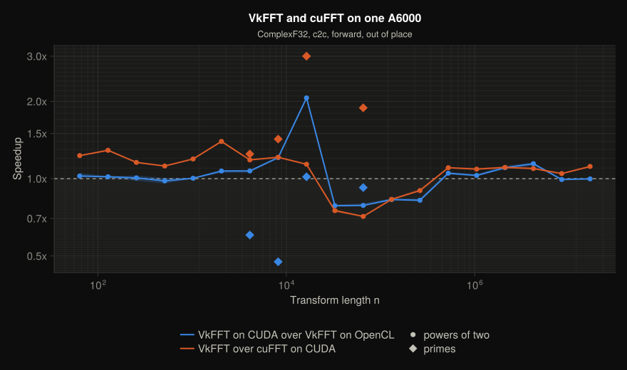
```@raw html
</div>
```

The same A6000 three ways. VkFFT on CUDA over VkFFT on OpenCL is the cost of
the API, since the kernels are the same. VkFFT over cuFFT, both on CUDA, is the
difference between the two kernel generators.

The API costs nothing at most lengths. The exceptions are ``2^{14}``, where
OpenCL takes twice as long, and most primes, where OpenCL is faster.

## Speed by transform shape

```@raw html
<div class="docs-light-only">
```
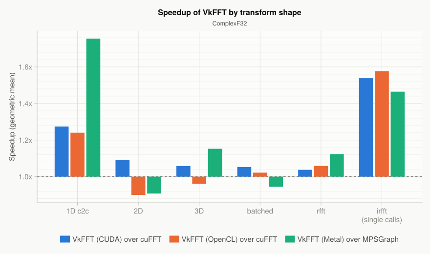
```@raw html
</div><div class="docs-dark-only">
```
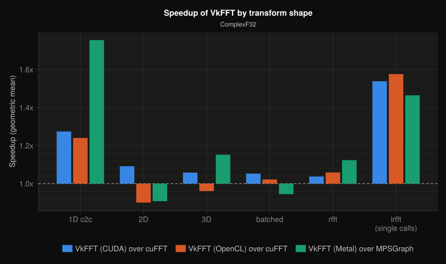
```@raw html
</div>
```

Geometric mean speedup per shape, in single precision. The lead is largest on 1D
complex transforms. On `rfft`, 2D, 3D and batched transforms it shrinks to
within about 15% either way. The `irfft` bars are single calls, see above.

## Accuracy

```@raw html
<div class="docs-light-only">
```
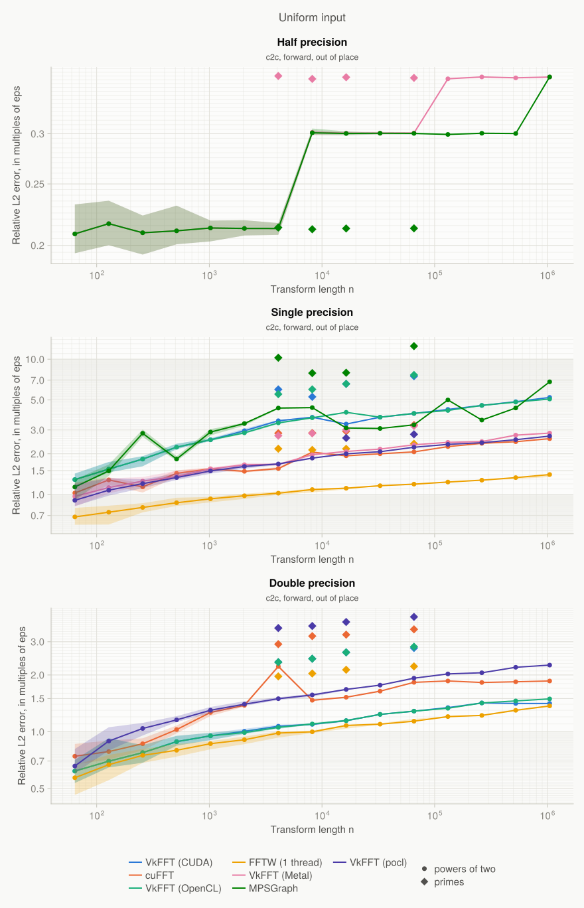
```@raw html
</div><div class="docs-dark-only">
```
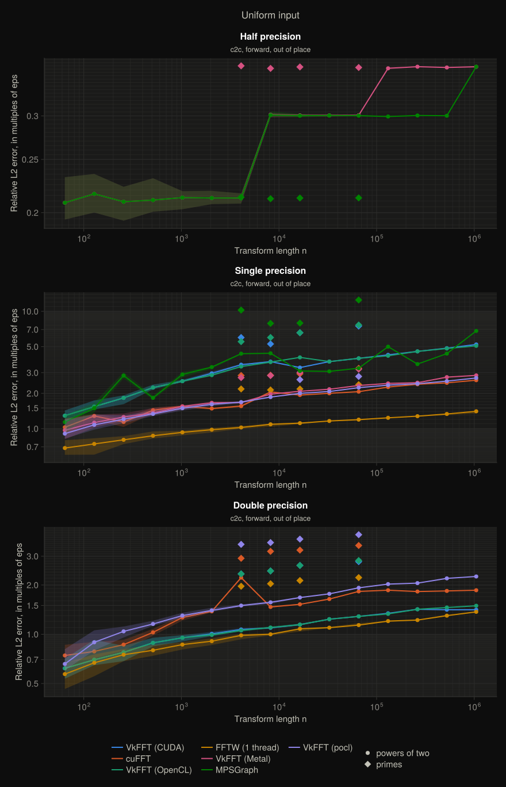
```@raw html
</div>
```

Relative L2 error against a higher-precision reference, in units of the
precision's epsilon. On powers of two every implementation stays within a few
epsilons. In
single precision VkFFT's error is about twice cuFFT's, and in double precision
it is below it. VkFFT computes half precision in single and only stores it in
half, so its half-precision error sits below one half-precision epsilon.

```@raw html
<div class="docs-light-only">
```
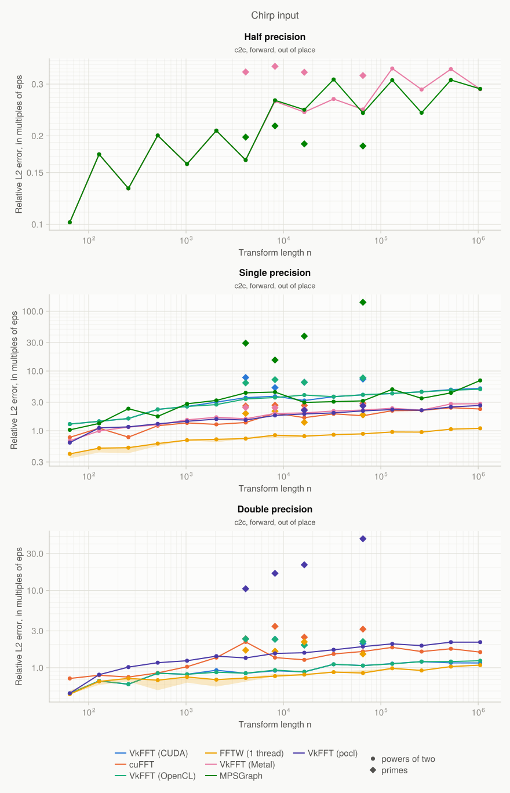
```@raw html
</div><div class="docs-dark-only">
```
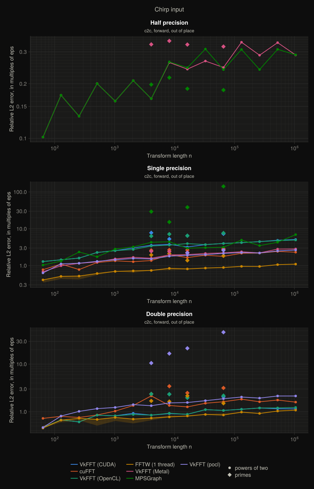
```@raw html
</div>
```

Uniform input hides the error at prime lengths, because its spectrum is
dominated by one bin. A chirp spreads it out. On a chirp, VkFFT in double
precision through pocl grows to 47 epsilons at 65521 points, against 2.2 on the
A6000's OpenCL driver, and MPSGraph in single precision reaches 141.

## Tuning

```@raw html
<div class="docs-light-only">
```
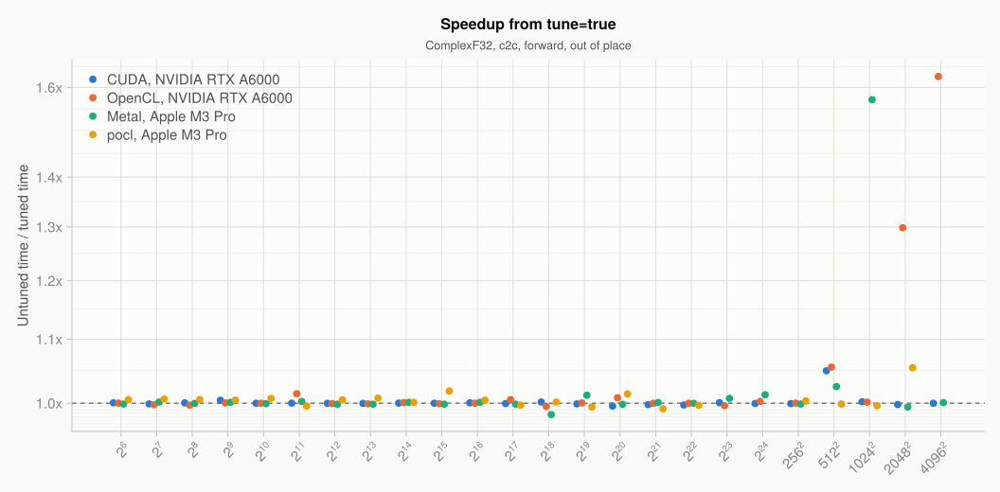
```@raw html
</div><div class="docs-dark-only">
```
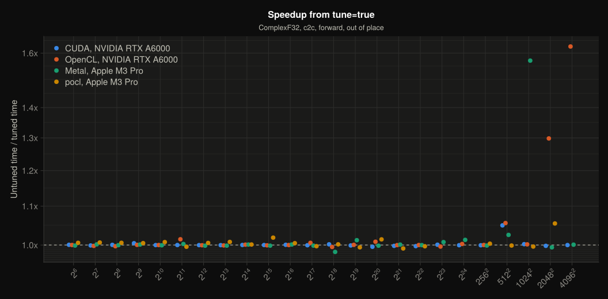
```@raw html
</div>
```

`tune=true` changes nothing on almost every shape. It pays off on large 2D
transforms: 1.57x at 1024² on Metal, and 1.30x at 2048² and 1.63x at 4096²
through OpenCL on the A6000. See [Tuning](tuning.md).

```@raw html
<div class="docs-light-only">
```
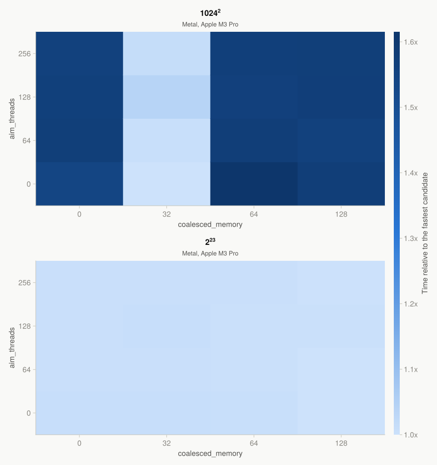
```@raw html
</div><div class="docs-dark-only">
```
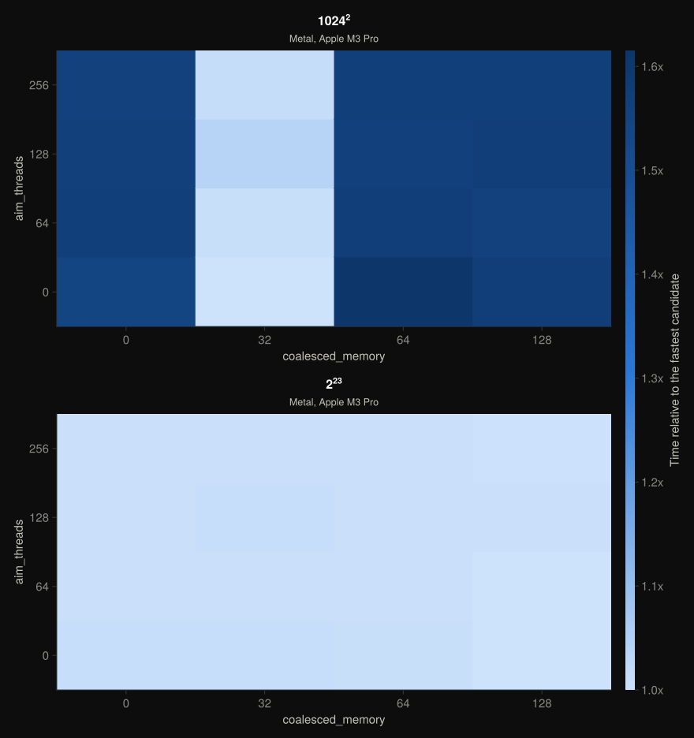
```@raw html
</div>
```

The tuner's 16 candidates on Metal, relative to the fastest, for the shape
tuning helps most and for one it does not help. At 1024² one value of
`coalesced_memory` is 1.6x faster than the rest. At ``2^{23}`` every candidate
is within 1% of the best.
